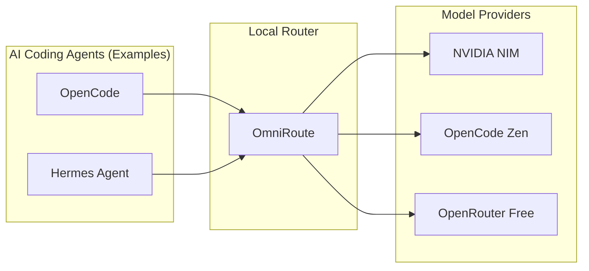

# Free AI Agent Stack

**Free AI Agent Stack** shows how to use AI coding agents without paying for model API access.

It uses **[OmniRoute](https://github.com/diegosouzapw/OmniRoute)** as a local router on your computer to connect free model offerings from **NVIDIA NIM**, **OpenCode Zen**, and **OpenRouter Free** behind a single local endpoint. Your coding agent connects once to OmniRoute, which handles model priority and fallback across providers.

---

## Architecture



**OpenCode** and **Hermes Agent** are the two agents demonstrated in this repository. Other tools that support custom OpenAI-compatible endpoints may also work.

---

## Repository Structure

```text
Free-AI-Agent-Stack/
├── README.md
├── AI_SETUP_PROMPT.md
├── docs/
│   ├── HOW_IT_WORKS.md
│   ├── PROS_AND_CONS.md
│   └── MANUAL_SETUP.md
└── LICENSE
```

* **[`docs/HOW_IT_WORKS.md`](docs/HOW_IT_WORKS.md)** — How OmniRoute, the providers, and priority/fallback routing fit together.
* **[`docs/PROS_AND_CONS.md`](docs/PROS_AND_CONS.md)** — Advantages, limitations, and privacy considerations.
* **[`docs/MANUAL_SETUP.md`](docs/MANUAL_SETUP.md)** — Configuration reference for setting up the stack manually.
* **[`AI_SETUP_PROMPT.md`](AI_SETUP_PROMPT.md)** — Prompt to give an already-installed AI coding agent to configure the setup with you.
* **[`LICENSE`](LICENSE)** — MIT License.

---

## Where to Start

Choose one of two paths:

* **Manual setup**: Read **[`docs/HOW_IT_WORKS.md`](docs/HOW_IT_WORKS.md)** and follow **[`docs/MANUAL_SETUP.md`](docs/MANUAL_SETUP.md)**.
* **AI-assisted setup**: Install an AI coding agent first, then give it the prompt in **[`AI_SETUP_PROMPT.md`](AI_SETUP_PROMPT.md)**. The prompt cannot run on its own without an installed agent.

### Official Links

* **OmniRoute**: [https://github.com/diegosouzapw/OmniRoute](https://github.com/diegosouzapw/OmniRoute)
* **OpenCode**: [https://opencode.ai/](https://opencode.ai/)
* **Hermes Agent**: [https://hermes-agent.nousresearch.com/](https://hermes-agent.nousresearch.com/)

---

## Limitations Notice

Free model catalogs and rate limits change frequently. OmniRoute runs locally, but model inference runs on the providers' remote servers—check each provider's privacy policy before sending sensitive code. See **[`docs/PROS_AND_CONS.md`](docs/PROS_AND_CONS.md)** for details.
