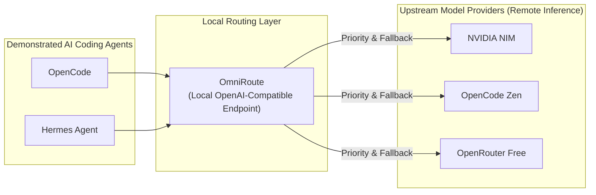

# Free AI Agent Stack

Welcome to the **Free AI Agent Stack**—a beginner-friendly guide to experimenting with AI coding agents without paying for model API access.

When you use an AI coding agent to explore a codebase, draft changes, or debug errors, a single session can send dozens of requests. Relying on a single free model tier often means running into sudden rate limits or temporary outages right in the middle of a task.

This project shows how to place **[OmniRoute](https://github.com/diegosouzapw/OmniRoute)** on your machine as a local routing layer in front of three model providers that offer free access options: **NVIDIA NIM**, **OpenCode Zen**, and **OpenRouter Free**. Your coding agent connects to one local address, while OmniRoute manages provider selection, priority ordering, and fallback when supported.

---

## Architecture Overview



**OpenCode** and **Hermes Agent** are the two coding agent harnesses demonstrated in this repository. They are practical examples rather than the only compatible tools—other agents that support custom OpenAI-compatible endpoints may also work depending on the API features they require.

---

## Repository Structure

Each file in this repository covers one part of the setup:

```text
free-ai-agent-stack/
├── README.md                  # Project overview and navigation guide
├── docs/
│   ├── GETTING_STARTED.md     # Prerequisites and installing an AI coding agent first
│   ├── HOW_IT_WORKS.md        # Architecture, routing concepts, and request flow
│   ├── PROS_AND_CONS.md       # Honest evaluation of benefits, limits, and privacy
│   └── MANUAL_SETUP.md        # Conceptual walkthrough of manual configuration
├── AI_SETUP_PROMPT.md         # Reusable prompt for automated agent-assisted setup
└── LICENSE                    # MIT License
```

### Where Should I Start?

* **New to AI coding agents?** Start with **[Getting Started](docs/GETTING_STARTED.md)** to learn what you need installed before configuring the router.
* **Want an AI agent to configure the stack with you?** Read **[Getting Started](docs/GETTING_STARTED.md)** first, then give **[AI Setup Prompt](AI_SETUP_PROMPT.md)** to your installed coding agent.
* **Want to understand the architecture first?** Read **[How It Works](docs/HOW_IT_WORKS.md)** and **[Pros and Cons](docs/PROS_AND_CONS.md)**.
* **Prefer configuring everything yourself?** Follow **[Manual Setup](docs/MANUAL_SETUP.md)** for a detailed explanation of every component and setting.

---

## Prerequisites at a Glance

Before setting up the routing stack, you will need:

* A computer running Linux, macOS, or Windows (native or WSL2).
* **Node.js** and **npm** to install and run [OmniRoute](https://github.com/diegosouzapw/OmniRoute).
* An installed AI coding agent harness—such as [OpenCode](https://opencode.ai/) or [Hermes Agent](https://hermes-agent.nousresearch.com/)—especially if you plan to use the automated setup prompt in [`AI_SETUP_PROMPT.md`](AI_SETUP_PROMPT.md).
* Free accounts with one or more of the three supported model providers: [NVIDIA NIM](https://build.nvidia.com/), [OpenCode Zen](https://opencode.ai/zen), and [OpenRouter](https://openrouter.ai/).

---

## Limitations and Privacy Notice

This project is an educational resource for learning and experimentation. Free model offerings have variable rate limits, changing model catalogs, and inconsistent availability, so they should not be treated as drop-in replacements for paid frontier models.

> [!IMPORTANT]
> **Local Routing Is Not Local Inference**: OmniRoute runs on your computer, but the AI models themselves run on remote cloud servers. Every prompt and code snippet your agent sends is transmitted to the selected upstream provider. Review **[Pros and Cons](docs/PROS_AND_CONS.md)** before using this setup with sensitive or private code.

---

## Official Links & License

* **OmniRoute Repository**: [https://github.com/diegosouzapw/OmniRoute](https://github.com/diegosouzapw/OmniRoute)
* **License**: Released under the [MIT License](LICENSE).
