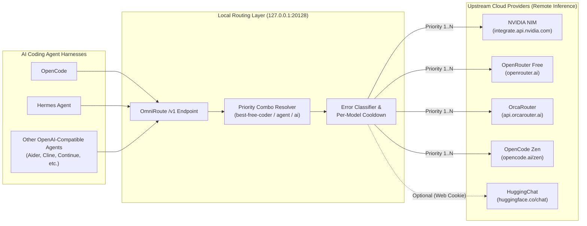

# Free AI Agent Stack

A practical, vendor-neutral documentation guide for running AI coding agents at **$0 inference cost** by combining free model offerings from multiple cloud providers behind [OmniRoute](https://github.com/diegosouzapw/OmniRoute), an open-source local AI router.

> [!NOTE]
> **Educational Project**: This repository is an educational reference demonstrating how to stack and route free-tier APIs for experimentation and learning. It does **not** provide unlimited usage, guaranteed uptime, or paid frontier-model performance.

---

## Why This Project Exists

Experimenting with agentic coding workflows—where an AI agent reads files, runs tests, and iterates on code—typically consumes large volumes of tokens across multi-turn tool calls. Relying on a single free provider quickly hits rate limits (requests per minute), daily quotas, or sudden model deprecations.

Instead of wiring one provider directly into one coding tool, this stack places **OmniRoute** between your coding agent and multiple upstream providers:

1. **Single Unified Endpoint**: Your coding agent connects once to `http://127.0.0.1:20128/v1`.
2. **Multi-Provider Aggregation**: You connect your own free accounts from multiple providers to OmniRoute.
3. **Priority Combos & Fallback**: You define ordered model chains (combos) such as `best-free-coder`, `best-free-agent`, and `best-free-ai`. When the primary model hits a rate limit (`429`) or temporary upstream error (`5xx`), OmniRoute can advance to the next healthy model in the chain.

---

## Architecture

---

## Providers & Tools in Scope

### Routing Layer

* **[OmniRoute](https://github.com/diegosouzapw/OmniRoute)**: A local-first, OpenAI-compatible AI gateway (`http://127.0.0.1:20128/v1`) and web dashboard (`http://127.0.0.1:20128`). It stores provider credentials locally in SQLite (`~/.omniroute/storage.sqlite`), normalizes upstream wire formats, and routes requests across named model combos.

### Upstream Model Providers

Free access means different things across providers. It is important to distinguish between a **rate-limited developer tier**, a **daily/RPM-capped free catalog**, **shared-pool free models**, and **web-session chat**:

| Provider | Official Link | OmniRoute ID | Auth Method | How the Free Offering Works | Verified Used Models in This Stack |
| :--- | :--- | :--- | :--- | :--- | :--- |
| **NVIDIA NIM** | [build.nvidia.com](https://build.nvidia.com/) | `nvidia` | Bearer API Key (`nvapi-...`) | **Developer rate-limited access**: Free developer tier (~40 RPM limit; subject to account credit/rate policies rather than a fixed monthly token grant). | `nvidia/nemotron-3-ultra-550b-a55b` `mistralai/mistral-large-4-1t-a52b` `nvidia/nemotron-3-nano-omni-30b-a3b-reasoning` `google/gemma-4-31b-it` `poolside/laguna-xs-2.1` `nvidia/nemotron-3.5-lightning-30b-a3b` `nvidia/nemotron-3.5-super-vl-120b-a12b` `stepfun-ai/step-5-preview` |
| **OpenRouter Free** | [openrouter.ai](https://openrouter.ai/) | `openrouter` | Bearer API Key (`sk-or-...`) | **Free-quota `:free` catalog**: Models suffixed with `:free` cost $0/token but enforce strict per-account rate limits (typically 20 RPM and 200 requests/day on zero-balance accounts). Available `:free` models rotate frequently. | `nvidia/nemotron-3-ultra-550b-a55b:free` `cohere/north-mini-code:free` `nvidia/nemotron-3-nano-omni-30b-a3b-reasoning:free` `dots-studio/dots-3-note-preview:free` `nvidia/nemotron-3.5-lightning:free` `nvidia/nemotron-3.5-super-vl:free` `recursive/flint-v1.0:free` `xingchen-agi/xing4.0-29b-a4b:free` |
| **OrcaRouter** | [orcarouter.ai](https://www.orcarouter.ai/) | `orcarouter` | Bearer API Key (`sk-orca-...`) | **Shared-capacity free models**: Models suffixed with `-free` cost $0/token but share upstream pool capacity and frequently return `429` (`free_rate_limited`) under load. | `tencent/hy4-preview-free` |
| **OpenCode Zen** | [opencode.ai/zen](https://opencode.ai/zen) | `opencode-zen` | Bearer API Key | **Rotating free tier**: Offers selected `-free` models at $0/token alongside paid models. Free models are subject to usage limits (`429 Free usage limit reached`) and periodic catalog rotation. | `mimo-v2.5-free` |
| **HuggingChat** | [huggingface.co/chat](https://huggingface.co/chat/) | `huggingchat` | Browser `Cookie` Header (`hf-chat`) | **Free web chat session**: Backed by HuggingChat's web interface rather than an official Bearer API. Requires copying session cookies from a browser and is prone to `502 Bad Gateway` errors when cookies expire or hit anti-bot HTML challenges. | *Supported at the provider level; excluded from active priority combos due to web-cookie session fragility.* |

> [!IMPORTANT]
> **Always Verify Live Model IDs**: Free-tier model catalogs change without notice. A model that is free and active today may return `404` (not found) or `410` (shut down) next week. Always verify active model identifiers against OmniRoute's `/v1/models` endpoint before adding them to your configuration.

### Compatible AI Coding Agent Harnesses

This guide demonstrates two agent harnesses used by the project author:

* **[OpenCode](https://opencode.ai/)**: An open-source terminal coding agent that connects to OmniRoute via `@ai-sdk/openai-compatible` or OmniRoute's built-in `omniroute setup-opencode` command.
* **[Hermes Agent](https://hermes-agent.nousresearch.com/)**: Nous Research's autonomous CLI and gateway agent, configured via `~/.hermes/config.yaml`.

**These are examples, not the only compatible tools.** Any AI coding agent or IDE extension that supports a custom OpenAI-compatible Base URL (`http://127.0.0.1:20128/v1`) and Bearer API key—such as Aider, Cline, Continue, Roo Code, Goose, or Claude Code / Codex CLI (via `omniroute run`)—can use this exact setup.

---

## General Workflow

1. **Install and start OmniRoute** locally on `127.0.0.1:20128`.
2. **Create accounts** with the upstream providers you want to use and add their credentials in the OmniRoute dashboard or CLI.
3. **Sync and verify models** so OmniRoute knows which free models are currently live on each connected provider.
4. **Create priority combos** (`best-free-coder`, `best-free-agent`, `best-free-ai`) that order your verified free models from first choice to fallback.
5. **Generate a local OmniRoute API key** (`OMNIROUTE_API_KEY`) and point your coding agent harness at `http://127.0.0.1:20128/v1`.
6. **Test connectivity** with a minimal request before starting a multi-turn coding session.

---

## Prerequisites

* **Operating System**: Linux, macOS, Windows (native or WSL2).
* **Node.js & npm**: Node.js 20 LTS or newer (Node.js 22+ recommended for built-in `node:sqlite` support).
* **Command-Line Utilities**: `curl` (for endpoint verification) and `git`.
* **Provider Accounts**: Free accounts on one or more of the providers in scope (NVIDIA NIM, OpenRouter, OrcaRouter, OpenCode Zen, HuggingChat).
* **An AI Coding Harness**: [OpenCode](https://opencode.ai/), [Hermes Agent](https://hermes-agent.nousresearch.com/), or another OpenAI-compatible coding client.

---

## Limitations & Realistic Expectations

* **Rate Limits & Shared Capacity**: Free tiers enforce strict requests-per-minute (RPM), requests-per-day (RPD), or shared pool capacity limits. During peak hours, free endpoints on OpenRouter, OrcaRouter, and OpenCode Zen regularly return `429 Too Many Requests`.
* **How Fallback Actually Works**: OmniRoute's priority fallback advances to the next model in a combo when an upstream provider returns a classified retryable or lockout error—such as `429` (rate limit), `402` (plan/quota exhausted), `500`/`502`/`503`/`504` (server error), or `404`/`410` (model unavailable). **Not every error triggers automatic fallback:**
  * Client-side `400 Bad Request` errors caused by unsupported parameters or malformed tool schemas may fail immediately.
  * If a failure happens mid-stream *after* SSE tokens have already started streaming to your agent, the router cannot transparently replay the turn on a different model.
  * If every model in your combo is simultaneously rate-limited, the request will fail until a cooldown window expires.
* **Model Churn**: Free models are frequently added, renamed, or retired (`404`/`410`). You will occasionally need to re-sync your provider catalogs and update your combo lists.
* **Tool-Calling & Context Variance**: Not all free models handle complex multi-step tool calling, strict JSON schemas, or large context windows equally well.

---

## Privacy & Security Warning

> [!CAUTION]
> **Local Routing Does Not Mean Local Inference**
>
> OmniRoute runs locally on your machine (`127.0.0.1:20128`), which means your API keys and routing rules stay in your local database (`~/.omniroute/storage.sqlite`). **However, every prompt, file snippet, tool output, and code diff processed by your coding agent is transmitted over the internet to the upstream cloud provider serving that request.**

Before using this stack on any codebase:

1. **Assume Free Tiers May Log or Train on Prompts**: Data retention, logging, and model-training policies vary by provider and sometimes per model. Several free-tier providers subsidize $0 inference by logging prompts and completions for model evaluation or training unless you explicitly configure zero-data-retention settings (and some free models require data-sharing opt-in to function).
2. **Never Send Secrets or Confidential Code**: Never route passwords, API keys, `.env` files, private cryptographic keys, customer PII, or proprietary/confidential source code through third-party free tiers without verifying the provider's current terms of service and privacy policy.
3. **Protect Your Credentials**:
   * Store your OmniRoute key and upstream provider keys in environment variables (such as `OMNIROUTE_API_KEY`) or local uncommitted `.env` files with restricted permissions (`chmod 600`).
   * Reference environment variables in agent configs (for example, `"{env:OMNIROUTE_API_KEY}"` in OpenCode) rather than hardcoding plaintext keys.
   * Always exclude `.env`, `opencode.json` (if it contains keys), `auth.json`, and `*.sqlite` files in `.gitignore`.

---

## Setup Guides

Choose the setup path that fits your workflow:

1. **[Manual Setup Guide (`MANUAL_SETUP.md`)](./MANUAL_SETUP.md)**: Complete step-by-step instructions for installing OmniRoute, configuring provider credentials, building the `best-free-coder` / `best-free-agent` / `best-free-ai` priority combos, connecting OpenCode and Hermes Agent, and troubleshooting common upstream HTTP errors.
2. **[AI-Assisted Setup Prompt (`AI_SETUP_PROMPT.md`)](./AI_SETUP_PROMPT.md)**: A reusable, safety-first prompt you can paste directly into your coding agent so it inspects your OS, asks for your approval before making changes, configures OmniRoute and your harness without exposing API keys, and verifies connectivity.

---

## License

This project is released under the [MIT License](./LICENSE).
