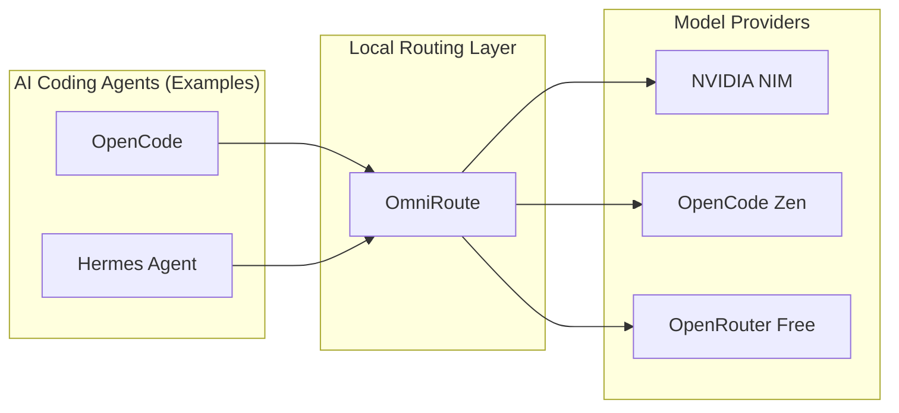

# Free AI Agent Stack

**Free AI Agent Stack** is a guide that shows how to use AI coding agents without paying for model API access.

When you use an AI coding agent to read files, write code, or fix bugs, the agent sends many requests to an AI model. If you use only one free provider, you can quickly hit usage limits or wait in long queues.

This project uses **[OmniRoute](https://github.com/diegosouzapw/OmniRoute)** as a local routing program on your computer. OmniRoute connects free model offerings from three providers—**NVIDIA NIM**, **OpenCode Zen**, and **OpenRouter Free**—behind one local address. Your AI coding agent sends requests to OmniRoute, and OmniRoute forwards them to your chosen provider.

---

## Architecture Diagram



**OpenCode** and **Hermes Agent** are the two coding agents demonstrated in this guide. They are examples, not the only compatible tools.

---

## Project Files

```text
Free-AI-Agent-Stack/
│
├── README.md
├── AI_SETUP_PROMPT.md
│
├── docs/
│   ├── HOW_IT_WORKS.md
│   ├── PROS_AND_CONS.md
│   └── MANUAL_SETUP.md
│
└── LICENSE
```

* **[`docs/HOW_IT_WORKS.md`](docs/HOW_IT_WORKS.md)**: Understand how the setup works and how requests move from your agent to the models.
* **[`docs/PROS_AND_CONS.md`](docs/PROS_AND_CONS.md)**: Read an honest evaluation of the benefits, limits, and privacy rules.
* **[`docs/MANUAL_SETUP.md`](docs/MANUAL_SETUP.md)**: Learn how to configure every part of the setup yourself.
* **[`AI_SETUP_PROMPT.md`](AI_SETUP_PROMPT.md)**: Copy this prompt into an installed AI coding agent so it can help configure everything with you.
* **[`LICENSE`](LICENSE)**: MIT License for this repository.

---

## Where Should I Start?

You can set up this project in two ways:

1. **Manual setup**: Read **[`docs/HOW_IT_WORKS.md`](docs/HOW_IT_WORKS.md)** and **[`docs/MANUAL_SETUP.md`](docs/MANUAL_SETUP.md)** to configure OmniRoute, your providers, and your AI agent step by step.
2. **AI-assisted setup**: First install an AI coding agent on your computer, then give it the prompt inside **[`AI_SETUP_PROMPT.md`](AI_SETUP_PROMPT.md)**.

> [!IMPORTANT]
> **The AI setup prompt cannot run by itself.** It is a text instruction for an AI coding agent. Before you can use [`AI_SETUP_PROMPT.md`](AI_SETUP_PROMPT.md), you must already have an AI coding agent installed on your computer that can read files and run commands with your permission.

### Official Tool Links

* **OmniRoute**: [https://github.com/diegosouzapw/OmniRoute](https://github.com/diegosouzapw/OmniRoute)
* **OpenCode**: [https://opencode.ai/](https://opencode.ai/)
* **Hermes Agent**: [https://hermes-agent.nousresearch.com/](https://hermes-agent.nousresearch.com/)

---

## Short Limitations Notice

* **Free limits change**: Providers can change their free usage limits or remove free models at any time.
* **Models run in the cloud**: OmniRoute runs on your computer, but the AI models run on the provider's remote servers.
* **Check privacy policies**: Because your prompts and code are sent to external servers, always check a provider's privacy policy before sending private or sensitive information.

Read **[`docs/PROS_AND_CONS.md`](docs/PROS_AND_CONS.md)** for a full explanation of these limitations.
