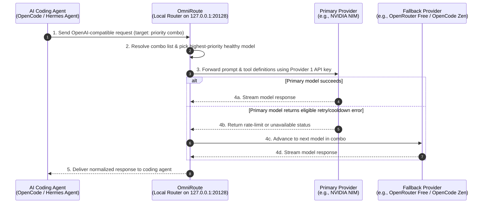

# How It Works

This document explains the architecture behind the **Free AI Agent Stack**: what each component does, how requests travel from your coding agent to an AI model and back, and how priority routing and fallback work in practice.

---

## 1. The Core Problem with Single-Provider Free Tiers

Connecting an AI coding agent directly to a single free model provider is simple, but it tends to break down quickly during real coding sessions.

Agentic workflows are chatty. A single task—such as explaining an error and updating two files—often involves multiple back-and-forth turns containing system instructions, file contents, and tool calls. When all of those requests hit one free provider directly:

* You can quickly reach that provider's requests-per-minute or daily usage cap.
* Free community pools can become congested during peak hours.
* When a provider retires or renames a free model, you have to edit your coding agent's configuration files manually to switch to a different model or provider.

---

## 2. Why Use OmniRoute as a Local Routing Layer?

**[OmniRoute](https://github.com/diegosouzapw/OmniRoute)** sits between your coding agent and the upstream cloud providers. Instead of teaching your coding agent how to talk to three different services and manually switching when one fails, you point your coding agent at OmniRoute's local endpoint once.

OmniRoute acts as a local traffic controller:

* **Unified Local Endpoint**: It exposes an OpenAI-compatible API on your local machine (by default at `http://127.0.0.1:20128/v1`) along with a local web dashboard (`http://127.0.0.1:20128`).
* **Centralized Provider Connections**: You register your upstream provider accounts inside OmniRoute rather than scattering API keys across multiple coding tools.
* **Virtual Model Combos**: It lets you group multiple models from different providers under a single name (a **combo**), ordered by priority.
* **Protocol Normalization**: It translates requests and responses between your agent and the selected upstream provider.

---

## 3. Request Flow

Every time you send a message in your coding agent, the request follows a five-stage path:



In short:

**AI Agent $\rightarrow$ OmniRoute $\rightarrow$ Selected Provider $\rightarrow$ Model Response $\rightarrow$ AI Agent**

---

## 4. The Three Providers in This Architecture

This project combines free offerings from three providers. Each provider structures its free access differently:

### NVIDIA NIM (`nvidia`)

**[NVIDIA NIM](https://build.nvidia.com/)** provides developer access to hosted inference endpoints for open-weights and partner models. Authentication uses a standard Bearer API key. Free access is governed by developer account terms and rate limits, which can change over time.

### OpenCode Zen (`opencode-zen`)

**[OpenCode Zen](https://opencode.ai/zen)** is a model gateway curated for coding agents. Alongside paid models, it offers selected free-tier models (commonly identified by a `-free` suffix). Free usage is subject to provider limits, and the specific models offered for free rotate periodically. Some models on OpenCode Zen may also enforce client or harness restrictions.

### OpenRouter Free (`openrouter`)

**[OpenRouter](https://openrouter.ai/)** aggregates models from many host providers behind one API. Models in its free catalog use the `:free` suffix and are billed at $0 per token, subject to per-account rate limits and daily request caps. Because upstream hosts add and retire free endpoints frequently, OpenRouter's `:free` catalog changes over time.

---

## 5. Understanding Model Identifiers

When you connect multiple providers to OmniRoute, two different providers might host the same underlying model. To keep every target unambiguous, OmniRoute prefixes the provider's identifier onto the upstream model's identifier:

```text
<provider-id>/<upstream-model-id>
```

For example:

* If **NVIDIA NIM** (`nvidia`) hosts a model named `nvidia/nemotron-3-ultra-550b-a55b`, OmniRoute refers to it as `nvidia/nvidia/nemotron-3-ultra-550b-a55b`.
* If **OpenRouter** (`openrouter`) hosts a free variant named `nvidia/nemotron-3-ultra-550b-a55b:free`, OmniRoute refers to it as `openrouter/nvidia/nemotron-3-ultra-550b-a55b:free`.
* If **OpenCode Zen** (`opencode-zen`) hosts a model named `mimo-v2.5-free`, OmniRoute refers to it as `opencode-zen/mimo-v2.5-free`.

Wait before copying any model identifier from documentation into your own configuration: **model catalogs are dynamic**. A model identifier that worked when a guide was written may be renamed or retired later. You should always inspect the live catalog returned by your connected providers before finalizing your setup.

---

## 6. Priority-Based Routing and Fallback

Instead of telling your coding agent to call a single hardcoded provider model, you can create a **Combo** in OmniRoute using a **priority** strategy.

### How Priority Selection Works

A priority combo is an ordered list of model identifiers—for example, placing a tested NVIDIA NIM model first, an OpenRouter `:free` model second, and an OpenCode Zen `-free` model third.

When your coding agent sends a request targeting that combo name, OmniRoute always checks the list from top to bottom and selects the first model that is currently marked healthy (not in a temporary cooldown window).

### How Fallback Works Conceptually

When the first model in a priority combo cannot fulfill a request, OmniRoute can place that model or connection into a temporary cooldown and try the next entry in the combo.

It is important to distinguish what fallback can and cannot do:

* **Pre-response upstream failures**: In the verified OmniRoute implementation, upstream failures such as rate-limit responses, quota exhaustion, temporary server errors, or missing-model responses before streaming starts can trigger a cooldown and advance to the next model in a priority combo. For multi-model catalog providers like NVIDIA NIM, OpenRouter, and OpenCode Zen, OmniRoute can cool down an individual unavailable model without disabling other models on the same provider account.
* **Not every error triggers fallback**: If your coding agent sends a request with invalid parameters that is rejected immediately as a bad request, or if every model in your combo is rate-limited at the same time, fallback cannot recover the request.
* **Mid-stream interruptions**: Once an upstream model has started streaming response tokens back to your coding agent, a network drop or mid-generation error cannot be transparently replayed on a different model without the coding agent retrying the turn.

---

## 7. How AI Harnesses Communicate with OmniRoute

An AI coding harness communicates with OmniRoute the same way it would communicate with any OpenAI-compatible API server. It needs three pieces of information:

1. **Base URL**: The local address where OmniRoute listens for OpenAI-compatible requests (default `http://127.0.0.1:20128/v1`).
2. **API Key**: A local authentication key generated in OmniRoute (stored in an environment variable such as `OMNIROUTE_API_KEY`) so your harness does not need to know your upstream provider keys.
3. **Model Name**: The name of the OmniRoute priority combo (or specific `provider/model` identifier) you want the agent to use.

In this repository:

* **[OpenCode](https://opencode.ai/)** connects through its `@ai-sdk/openai-compatible` provider configuration (`opencode.json`), referencing the local OmniRoute endpoint, environment variable key, and combo names.
* **[Hermes Agent](https://hermes-agent.nousresearch.com/)** connects through its local `config.yaml` file, pointing its model provider settings to the local OmniRoute endpoint and combo names.

Other coding agents that support custom OpenAI-compatible endpoints follow the same pattern, though behavior depends on whether the upstream free models support the specific tool-calling or context requirements of that harness.

---

## 8. Local Routing vs. Local Inference

One of the most common misconceptions about local AI routers is confusing **local routing** with **local inference**.

| Concept | Where It Runs | What Happens to Your Data |
| :--- | :--- | :--- |
| **Local Routing** *(OmniRoute)* | On your own computer (`127.0.0.1`) | Your routing rules and provider connections live locally, and your coding agent connects to a local port. |
| **Remote Cloud Inference** *(NVIDIA NIM, OpenCode Zen, OpenRouter Free)* | On external cloud servers operated by the provider or its hosts | Your prompts, code snippets, file contents, and tool outputs are sent over the internet to the selected provider to generate a response. |

Running OmniRoute locally does **not** run the AI models on your hardware. Every prompt processed through this setup leaves your machine and is handled by the upstream provider selected for that request. See **[Pros and Cons](PROS_AND_CONS.md)** for a full discussion of privacy and data-handling implications.
