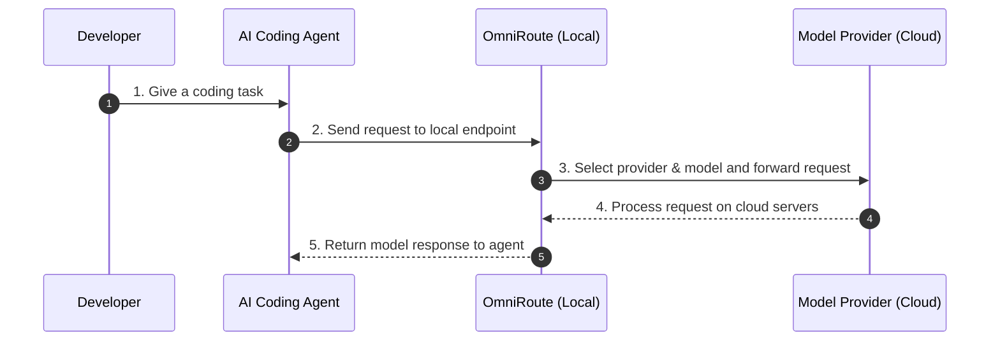

# How It Works

This page explains how the **Free AI Agent Stack** works. Reading this first will help you understand what each tool does before you configure anything.

---

## 1. What Is OmniRoute?

**[OmniRoute](https://github.com/diegosouzapw/OmniRoute)** is a small server program that runs on your own computer. It acts as a bridge between your AI coding agent and external AI model providers.

When OmniRoute is running, it provides two main things on your computer:

* **A local web dashboard**: A page you open in your browser to add provider accounts, choose models, and view request logs.
* **A local API endpoint**: A local web address (an *endpoint*) that uses the standard OpenAI API format so your AI coding agent can talk to it.

---

## 2. Why Use a Local Routing Layer?

A **routing layer** is a program that receives a request and decides where to send it.

If you connect your coding agent directly to one free provider, you have to edit your agent's settings every time that provider reaches its usage limit or removes a free model.

With OmniRoute sitting in the middle:

* You connect your coding agent to **one local address** once.
* You can connect **multiple providers** inside OmniRoute.
* You can switch models or fall back to another provider without changing your coding agent's settings.

---

## 3. What Are Model Providers?

A **model provider** is an online service that hosts AI models on powerful cloud servers and lets programs send prompts to those models over the internet using an **API key** (a secret password for programs).

---

## 4. Roles of the Three Providers in This Setup

This setup uses free offerings from three providers. Each one gives free access in a slightly different way:

* **[NVIDIA NIM](https://build.nvidia.com/)**: An API platform from NVIDIA that lets developers test hosted open-weights and partner AI models. Free usage is controlled by developer account rules and rate limits (how many requests you can send in a short time).
* **[OpenCode Zen](https://opencode.ai/zen)**: A model service built for coding agents. It offers a few free models (often ending with `-free`) alongside paid models. The free models have usage limits and can change over time.
* **[OpenRouter Free](https://openrouter.ai/)**: A service that gives access to many AI models through one account. Models that end with `:free` cost $0 per token, but they have daily and per-minute request limits.

---

## 5. What Is a Model ID?

A **model ID** (model identifier) is the exact name a program uses to ask for a specific AI model.

Because OmniRoute connects to multiple providers at the same time, it combines the **provider name** and the **provider's model name** with a slash (`/`):

```text
<provider-name>/<model-name>
```

For example:

* A model hosted on **NVIDIA NIM** (`nvidia`) begins with `nvidia/...`
* A free model hosted on **OpenCode Zen** (`opencode-zen`) begins with `opencode-zen/...`
* A free model hosted on **OpenRouter** (`openrouter`) begins with `openrouter/...` and ends with `:free`.

Because providers add and remove free models often, a model ID that works today might not exist next month. You should always check the live model list inside OmniRoute rather than trusting an old list.

---

## 6. How Does an AI Agent Communicate with OmniRoute?

Most AI coding tools know how to speak the **OpenAI API format**, which is a common standard for sending chat messages and tool calls to AI models.

To talk to OmniRoute, your AI coding agent only needs three settings:

1. **Base URL**: The local address where OmniRoute is listening on your computer.
2. **API Key**: A local key created inside OmniRoute so your agent is allowed to connect.
3. **Model Name**: The name of the model (or model group) you want OmniRoute to use.

### Basic Request Flow

Every time you ask your coding agent to do a task, five steps happen:

1. **You give a task** to your AI coding agent.
2. **The agent sends a request** to your local OmniRoute address.
3. **OmniRoute selects** a configured provider and model.
4. **The provider processes the request** on its remote servers.
5. **The response returns** through OmniRoute back to your coding agent.



---

## 7. What Is Priority-Based Routing?

In OmniRoute, you can create a **Combo**, which is a custom list of models grouped under one name (for example, `best-free-coder`).

When you choose **priority-based routing** for that combo, the order of the list matters:

* **Choice 1**: Your favorite free model from Provider A.
* **Choice 2**: A backup free model from Provider B.
* **Choice 3**: Another free model from Provider C.

Whenever your coding agent asks for `best-free-coder`, OmniRoute checks the list from top to bottom and picks the highest-ranked model that is currently available.

---

## 8. What Is Fallback?

**Fallback** is what happens when your first-choice model cannot answer right now, and OmniRoute automatically tries the next model in your priority list.

### A Simple Example

Imagine **Choice 1** on NVIDIA NIM reaches its per-minute rate limit while you are coding. Instead of stopping your work immediately, OmniRoute can temporarily pause Choice 1 and send the request to **Choice 2** on OpenRouter Free.

### Important Limits of Fallback

Do not expect every error to trigger fallback automatically. Whether fallback happens depends on OmniRoute's current implementation, your settings, and the type of error:

* If a provider rejects a request before generating an answer (for example, because a limit was reached or a service is temporarily busy), OmniRoute can often try the next model in the list.
* If a model has already started sending words back to your agent and the connection drops halfway through, the router cannot smoothly restart that answer on a different model by itself.
* If every model in your priority list has reached its free limit at the same time, the request will still fail until one of the limits resets.

---

## 9. How OpenCode and Hermes Agent Fit Into This Setup

An **AI coding agent** is the program you run in your terminal to read your project files, run commands, and apply code changes.

This project demonstrates two AI coding agents:

* **[OpenCode](https://opencode.ai/)**: An open-source terminal coding agent configured with a local JSON file (`opencode.json`).
* **[Hermes Agent](https://hermes-agent.nousresearch.com/)**: A command-line coding and assistant agent configured with a local YAML file (`config.yaml`).

Neither agent runs the AI model itself. Both agents act as the user interface on your computer and send their model requests to OmniRoute. Other coding tools that support custom OpenAI-compatible endpoints can also be used if OmniRoute and the selected free models support the API features those tools require.

---

## 10. Local Routing vs. Local Inference

It is very important to understand the difference between **local routing** and **local inference**:

* **Local routing** means the traffic controller (**OmniRoute**) runs on your computer. It decides which provider receives your request.
* **Local inference** means the AI model itself runs on your computer's own processor or graphics card without using the internet.

**This setup uses local routing, not local inference.**

Even though your coding agent connects to a local address on your computer, OmniRoute forwards your prompts and code over the internet to **NVIDIA NIM**, **OpenCode Zen**, or **OpenRouter Free**. To understand what this means for privacy and daily use, read **[`docs/PROS_AND_CONS.md`](PROS_AND_CONS.md)** next.
